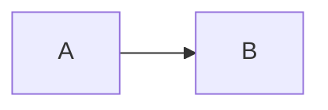

# Mac editor corpus

This paragraph exercises **bold**, *italic*, <u>underline</u>, ~~strike~~, `inline code`, and [a link](https://example.com).

## Lists

- one
- two
  - nested

1. first
2. second

- [ ] unfinished
- [x] finished

> A quote with a [^note].

| Name | Value |
| --- | ---: |
| alpha | 1 |
| beta | 2 |

```swift
let value = 42
print(value)
```



$$
E = mc^2
$$

<!-- studynotes:block id="11111111-1111-1111-1111-111111111111" type="data-table" version="1" -->
| Name | Score |
| --- | ---: |
| Ada | 10 |
<!-- /studynotes:block -->

<section data-raw-html="true">
  <p>Raw HTML is preserved.</p>
</section>

[^note]: Footnote definition.
