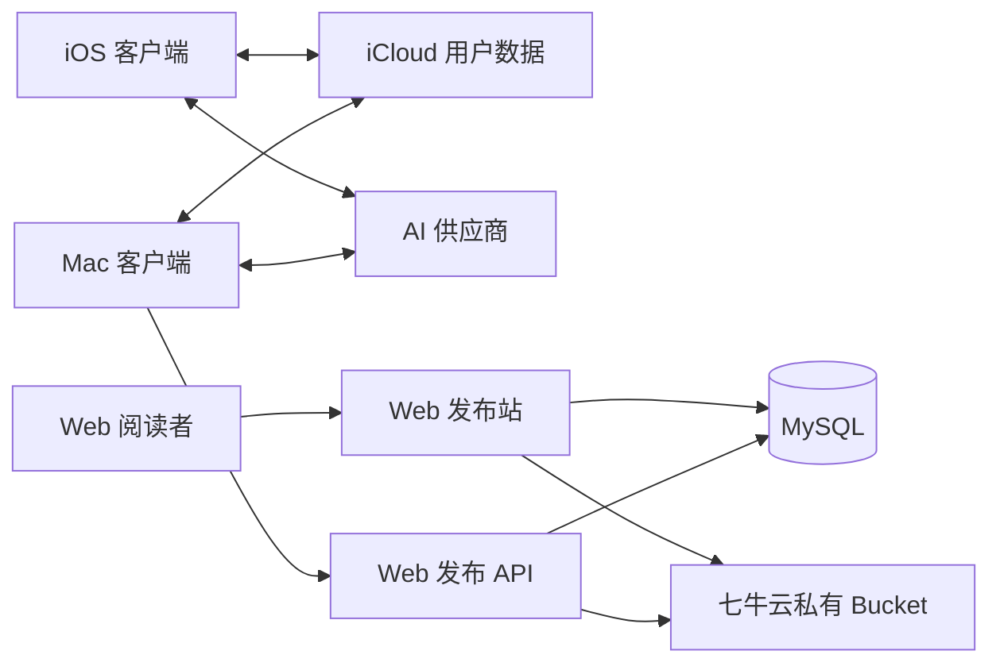

# StudyNotes 产品文档

| 项目 | 内容 |
| --- | --- |
| 文档版本 | 1.0 |
| 状态 | 已确认基线 |
| 日期 | 2026-11-02 |
| 产品形态 | 个人单实例学习工具 |
| 客户端 | Mac、iPhone/iPad、Web 发布站 |
| 首版语言 | 简体中文 |

相关文档：

- [领域词汇表](../GLOSSARY.md)
- [ADR 目录](./adr/)

## 1. 产品概述

StudyNotes 是一款帮助个人学习者收集、整理、研读、标注、复用和发布学习资料的工具。它不以团队协作或通用内容创作为目标，而是围绕一条完整学习闭环工作：

```text
收集/导入
→ 整理进知识库
→ 阅读与标注
→ AI 研读
→ 复习
→ 选择发布
```

产品的核心价值是把散落在文件、网页和阅读器中的学习内容，转化为可搜索、可追溯、可复习、可由 AI 辅助理解，并且可以按需公开的个人知识资产。

## 2. 产品目标

### 2.1 核心目标

1. 让学习资料有稳定、清晰的归类和来源。
2. 让标注始终能回到原文位置，而不是成为脱离上下文的碎片。
3. 让 AI 围绕当前材料和选区工作，并明确展示发送了什么。
4. 让标注、AI 结果和笔记能够转化为复习材料。
5. 让整理后的文章可以通过 Mac 主动发布为只读 Web 文章。
6. 让所有用户数据可导出、可迁移，不被产品锁死。

### 2.2 成功标准

作为个人工具，不以用户增长和商业收入衡量首版，而以以下结果衡量：

1. 常用格式的学习资料能够顺利进入知识库并找到。
2. 阅读时产生的标注能够在 Mac 与 iOS 间同步并恢复位置。
3. 用户可以只靠 StudyNotes 完成一次完整的资料整理、研读和发布。
4. 发布文章不会泄漏默认私有的标注和 AI 结果。
5. 相同文章重复发布会保持链路稳定，不产生重复文章或版本回退。
6. 不必维护第二套云资料库，也无需运行 AI 推理服务器。

## 3. 用户与使用场景

### 3.1 用户

首版只有一个所有者用户：

- 使用 Mac 作为主要整理和研读设备。
- 使用 iPhone/iPad 进行碎片阅读、标注、收集和复习。
- 使用同一个 Apple ID 和 iCloud 同步本地学习数据。
- 自行维护 Web 服务器、MySQL、七牛云和 AI 供应商账户。

首版不包含管理员、成员、访客、读者账号等角色。

### 3.2 典型场景

- 把 PDF、网页、Markdown 或图片导入某个知识库，等待后续阅读。
- 在 iOS 上快速把网页、图片或文本放进收件箱，回到 Mac 后统一整理。
- 阅读时高亮文字、框选图片区域或标注页面，并补充自己的理解。
- 针对某段内容请求 AI 解释，或针对章节请求总结。
- 把标注或 AI 问题加入复习，按间隔回顾。
- 从 Mac 选择一篇文章，开启或关闭标注、AI 结果，发布到 Web。
- 在 Web 上浏览公开文章，或通过不可猜链接打开未列出文章。

## 4. 产品原则

### 4.1 学习闭环优先

新增功能必须明确服务于收集、整理、阅读、标注、AI 研读、复习或发布。否则默认不进入范围。

### 4.2 本地优先

Mac 和 iOS 的用户数据以 iCloud 为同步来源；只有用户主动发布的内容才进入 Web 服务。

### 4.3 AI 显式触发

AI 不在后台自动扫描、分类或上传材料。每次请求必须由用户主动发起，并对发送范围作出清晰说明。

### 4.4 发布是独立动作

本地资料与 Web 发布内容拥有两套生命周期。本地修改、移动或删除不会自动改变 Web。

### 4.5 不照搬语雀

保留语雀有价值的信息组织与阅读模式，删除团队协作、通用办公和社交能力；必须保留的创作能力采用学习场景下的轻量形态。

### 4.6 数据可迁移

原始文件、笔记、阅读副本和标注都能以通用格式导出，不依赖专有数据库才能阅读。

## 5. 范围

### 5.1 长期范围内

- 多知识库、嵌套文件夹和标签。
- Markdown、HTML、网页文章、PDF、EPUB、DOCX 和图片。
- 阅读、目录、搜索和标注。
- Markdown 笔记。
- 文本 AI 解释、总结、复习问题和思维导图。
- 轻量间隔复习。
- 批量导入、批量导出。
- Mac 向云端 Web 发布站发布只读文章。
- 富文本、电子表格、数据表、流程图、白板和演示文稿。

### 5.2 首个可用版本范围内

- Mac 导入 Markdown、HTML、PDF、图片和网页文章。
- 多知识库、嵌套文件夹、标签和收件箱。
- 阅读、文字/区域/页面标注、全文关键词搜索。
- Markdown 笔记。
- AI 解释、总结和围绕结果追问。
- 发布到 Web，支持公开和未列出。
- iOS 浏览目录、按需下载、轻量标注、收件箱和离线保存。
- Web 公开列表、站内搜索、文章阅读、研读层和导出。

### 5.3 明确不做

- 团队空间、成员、权限、邀请。
- 多人实时编辑、评论回复、`@`、点赞、关注。
- 公开社区、消息中心、动态流和模板市场。
- 读者账号、注册、登录和个人主页。
- 课程表、任务管理、学习打卡和成就体系。
- 后台 AI 自动分析和自动上传学习材料。
- AI 语义搜索和跨资料自动问答。
- 通用文档格式转换服务。
- App Store 商业发行。
- 多租户、订阅计费和公共运营后台。

### 5.4 长期延后

- EPUB 原生阅读。
- DOCX 导入和转换。
- OCR。
- AI 复习问题与复习调度。
- AI 思维导图。
- 批量导出。
- AI 标签和知识库归类建议。
- 富文本、电子表格、数据表、流程图、白板和演示文稿。

## 6. 领域模型

### 6.1 核心对象

| 对象 | 定义 |
| --- | --- |
| 知识库 | 最高层分类容器，用于组织一组相关学习材料 |
| 文件夹 | 知识库内的嵌套分类结构 |
| 标签 | 可跨知识库复用的横向关联标记 |
| 学习材料 | 可被组织、阅读和检索的内容单元，包括导入资料、网页文章、图片和笔记 |
| 原始文件 | 导入或抓取时保留的不可变源文件或源内容 |
| 阅读副本 | 由 Markdown 或 HTML 原始内容生成、允许编辑并保存新版本的学习版本 |
| 笔记 | 可独立存在的 Markdown 学习材料，可关联其他材料 |
| 标注 | 绑定原文位置的私人批注 |
| 标注锚点 | 文本范围、图片矩形或页面区域等可恢复的位置信息 |
| AI 研读会话 | 绑定材料或选区、从固定动作开始并允许追问的有限会话 |
| AI 研读结果 | 保存在私人研读层、可由用户提升为其他内容的 AI 输出 |
| 复习项 | 从标注或 AI 问题转化、按间隔安排回顾的学习对象 |
| 发布版本 | 一次发布产生的不可变文章快照 |

### 6.2 关系约束

- 一份学习材料只属于一个知识库，可在文件夹内或知识库根目录。
- 标签与学习材料为多对多关系。
- 笔记可以关联零到多份其他学习材料。
- 同一原文位置只允许一个标注，不提供标注回复线程。
- AI 研读结果默认从属于当前材料或选区。
- 发布版本从一份可渲染为文章的学习材料生成。
- 公开或未列出的 Web 文章只引用发布版本，不实时读取本地材料。

## 7. 内容格式支持

| 格式 | 首个版本 | 阅读 | 标注 | AI 文本输入 | Web 发布 | 后续计划 |
| --- | --- | --- | --- | --- | --- | --- |
| Markdown | 是 | 是 | 是 | 是 | 是 | 持续完善 |
| HTML | 是 | 是 | 是 | 是 | 是 | 持续完善 |
| 网页文章 | 是 | 是 | 是 | 是 | 是 | 支持更稳健的正文提取 |
| PDF | 是 | 是 | 是 | 有文字层时是 | 否 | OCR 后支持扫描件 |
| 图片 | 是 | 是 | 是 | 否 | 否 | 视觉 AI 后续评估 |
| EPUB | 否 | 延后 | 延后 | 延后 | 延后 | 第二阶段原生阅读 |
| DOCX | 否 | 延后 | 延后 | 延后 | 延后 | 第二阶段转换为阅读副本 |

首版只能发布具有标准化文章正文的学习材料。PDF 和图片可以直接阅读、标注，但不作为首版 Web 文章发布。

## 8. 信息架构

### 8.1 Mac

Mac 是完整工作台，采用三栏布局：

```text
左侧：全局入口 + 知识库/文件夹树
中间：列表、搜索结果或收件箱
右侧：阅读器
```

左侧全局入口只有：

- 搜索
- 收件箱
- 最近阅读
- 待复习

顶部主操作固定为：

- 导入
- 新建笔记
- AI 研读
- 发布

阅读器内部提供可收起的“标注 / AI”侧栏。

### 8.2 iOS

iOS 使用四个底部入口：

- 资料库
- 收件箱
- 搜索
- 复习

“资料库”展示知识库、文件夹和最近阅读。阅读页全屏展示，目录、标注、AI 和文章设置通过底部面板或弹出层完成。

iOS 不提供发布和复杂批量整理。

### 8.3 Web 发布站

Web 只保留：

- 公开文章列表
- 全站搜索
- 文章阅读页
- 文章导出入口

不设置作者主页、知识库目录、推荐、排行、评论、点赞和读者账号。

## 9. 功能需求

优先级定义：

- `P0`：首个可用版本必须完成。
- `P1`：第二阶段完成。
- `P2`：长期能力。

### 9.1 知识库与整理

| 编号 | 优先级 | 需求 |
| --- | --- | --- |
| KB-01 | P0 | 用户可以创建、重命名、删除多个知识库 |
| KB-02 | P0 | 知识库内支持嵌套文件夹 |
| KB-03 | P0 | 学习材料可在文件夹间移动，也可位于知识库根目录 |
| KB-04 | P0 | 标签可跨知识库复用，一份材料可有多个标签 |
| KB-05 | P0 | 删除材料先进入回收站，30 天后可永久清理 |
| KB-06 | P0 | 笔记和阅读副本保留最近 10 个文字版本，可恢复 |
| KB-07 | P1 | AI 可以建议标签和知识库位置，但不得自动应用 |

### 9.2 导入与收集

| 编号 | 优先级 | 需求 |
| --- | --- | --- |
| IN-01 | P0 | Mac 支持单文件、多文件和文件夹拖入 |
| IN-02 | P0 | Mac 支持 Markdown、HTML、PDF、图片导入 |
| IN-03 | P0 | Mac 支持输入网址并抓取单篇正文与相关图片 |
| IN-04 | P0 | 抓取网页时允许用户调整正文范围 |
| IN-05 | P0 | Mac 监听指定 iCloud `Inbox`，发现新内容后送入收件箱 |
| IN-06 | P0 | iOS 支持把 URL、图片和文本快速放入 iCloud `Inbox` |
| IN-07 | P0 | 导入后复制到产品管理的 iCloud 目录，不直接编辑外部源文件 |
| IN-08 | P0 | 通过内容指纹提示重复材料，不静默覆盖 |
| IN-09 | P0 | 网页抓取不执行整站爬取、登录绕过和无限滚动采集 |

### 9.3 阅读

| 编号 | 优先级 | 需求 |
| --- | --- | --- |
| RD-01 | P0 | 阅读器支持目录和当前文档内搜索 |
| RD-02 | P0 | 阅读器支持正文中心布局，并可收起研读侧栏 |
| RD-03 | P0 | PDF 保留原始版式阅读 |
| RD-04 | P0 | Markdown 和 HTML 使用标准化阅读视图 |
| RD-05 | P0 | iOS 支持按需下载材料并明确离线保存状态 |
| RD-06 | P1 | EPUB 使用原生分页或滚动阅读体验 |
| RD-07 | P1 | DOCX 导入后转换为可阅读副本，不提供原始版式编辑 |

### 9.4 标注

| 编号 | 优先级 | 需求 |
| --- | --- | --- |
| AN-01 | P0 | 选中文字后提供“高亮”和“高亮并笔记” |
| AN-02 | P0 | 图片支持矩形区域标注 |
| AN-03 | P0 | PDF 有文字层时按文字锚定，否则按页面区域锚定 |
| AN-04 | P0 | 支持整页或整张图片级别的标注 |
| AN-05 | P0 | 同一原文位置只能存在一个标注，再次选择时编辑原标注 |
| AN-06 | P0 | 点击标注跳转到原文，点击原文标记定位标注 |
| AN-07 | P0 | 标注支持搜索、导出和加入复习 |
| AN-08 | P1 | EPUB 支持按文字锚定 |

### 9.5 笔记与编辑

| 编号 | 优先级 | 需求 |
| --- | --- | --- |
| NT-01 | P0 | 用户可以创建 Markdown 笔记 |
| NT-02 | P0 | 笔记可独立存在于知识库，也可关联多份学习材料 |
| NT-03 | P0 | Markdown/HTML 阅读副本可以编辑并保存为新版本 |
| NT-04 | P0 | 原始文件保持不可变 |
| NT-05 | P0 | 笔记和阅读副本的文字版本可恢复 |
| NT-06 | P0 | 不提供 Word 风格富文本编辑器、表格、白板和演示文稿 |

### 9.6 搜索

| 编号 | 优先级 | 需求 |
| --- | --- | --- |
| SR-01 | P0 | 搜索标题、正文、笔记、标注和 AI 文字结果 |
| SR-02 | P0 | 结果按学习材料、笔记、标注和 AI 结果分组 |
| SR-03 | P0 | 支持按知识库、内容类型、标签和更新时间筛选 |
| SR-04 | P0 | 搜索索引为本地派生数据，可重建 |
| SR-05 | P0 | 阅读页支持当前文档内搜索 |
| SR-06 | P1 | 图片和扫描版 PDF 通过本地 OCR 进入文本索引 |
| SR-07 | P1 | 不做 AI 语义搜索和跨资料自动问答 |
| SR-08 | P0 | iOS 对未下载材料只按标题、标签和目录元数据搜索；正文、标注和 AI 文字结果仅在材料已下载或已离线保存后进入全文搜索，界面必须明确显示当前搜索范围 |

### 9.7 AI 研读

| 编号 | 优先级 | 需求 |
| --- | --- | --- |
| AI-01 | P0 | 支持多个命名供应商配置，每个配置包含接口地址、模型 ID 和 API Key |
| AI-02 | P0 | 正式验收供应商为 DeepSeek，允许任意 OpenAI 兼容接口 |
| AI-03 | P0 | `OpenCode Go` 仅作为用户自担风险的实验性兼容接口 |
| AI-04 | P0 | API Key 保存至 Apple 钥匙串，并允许通过 iCloud 钥匙串同步 |
| AI-05 | P0 | AI 请求由 Mac/iOS 直连供应商，不经过自建 Web 服务 |
| AI-06 | P0 | 支持解释选中内容和总结材料/章节 |
| AI-07 | P0 | 支持围绕本次研读结果继续追问 |
| AI-08 | P0 | 发送前展示上下文范围与大致长度 |
| AI-09 | P0 | 发送整篇材料前必须获得用户确认 |
| AI-10 | P0 | 只发送最小必要文本，不自动发送图片与扫描件 |
| AI-11 | P0 | 输出流式显示，用户可以停止生成 |
| AI-12 | P0 | 失败后由用户手动重试，不自动重试、不自动切换供应商 |
| AI-13 | P0 | 保存用户问题、回答、模型 ID 和时间，可重命名或删除 |
| AI-14 | P1 | 支持生成复习问题和可编辑思维导图 |
| AI-15 | P1 | 支持 AI 标签与知识库归类建议，但必须由用户确认 |

### 9.8 复习

| 编号 | 优先级 | 需求 |
| --- | --- | --- |
| RV-01 | P1 | 标注可转化为复习项 |
| RV-02 | P1 | AI 复习问题可转化为复习项 |
| RV-03 | P1 | 复习项包含问题、答案和原文位置 |
| RV-04 | P1 | 用户可选择“忘记 / 模糊 / 掌握” |
| RV-05 | P1 | 按 1、3、7、14、30 天安排下次复习 |
| RV-06 | P1 | 到期时仅使用本地系统通知 |
| RV-07 | P1 | 不提供牌组市场、复杂算法参数和模板语言 |

### 9.9 发布

| 编号 | 优先级 | 需求 |
| --- | --- | --- |
| PB-01 | P0 | 只有 Mac 可以发起发布 |
| PB-02 | P0 | 发布前展示渲染预览、可见性、研读层开关和媒体状态 |
| PB-03 | P0 | 发布内容包含标题、正文、图片、标签和发布时间 |
| PB-04 | P0 | 默认不发布知识库结构、本地路径、标注和 AI 结果 |
| PB-05 | P0 | 提供“发布标注”和“发布 AI 研读结果”两个独立开关 |
| PB-06 | P0 | 研读层正文使用锚点和侧栏，AI 结果作为可折叠附录 |
| PB-07 | P0 | 相同内容重复发布不创建新版本 |
| PB-08 | P0 | 每次发布携带唯一请求标识，网络重试不得产生重复文章 |
| PB-09 | P0 | 内容变化时创建不可变新版本 |
| PB-10 | P0 | 旧版本请求不能覆盖新版本，服务端返回明确冲突 |
| PB-11 | P0 | Mac 可以下架、永久删除和回滚发布版本 |
| PB-12 | P0 | 修改、移动或删除本地材料不会自动改变 Web |
| PB-13 | P0 | 发布媒体上传至七牛云私有 Bucket |
| PB-14 | P0 | Mac 通过 Web 服务获取短时上传凭据，永久七牛云密钥不下发客户端 |
| PB-15 | P0 | 读者通过 Web 服务生成的短时签名 URL 获取媒体 |
| PB-16 | P1 | 支持批量发布和批量导出 |

### 9.10 Web 阅读

| 编号 | 优先级 | 需求 |
| --- | --- | --- |
| WB-01 | P0 | Web 不提供注册、登录、编辑和个人资料 |
| WB-02 | P0 | 公开文章出现在首页列表并进入站内搜索 |
| WB-03 | P0 | 未列出文章不出现在列表和站内搜索，只通过不可猜链接访问 |
| WB-04 | P0 | 每篇文章使用永久随机文章 ID，标题变化不改变 URL |
| WB-05 | P0 | 未列出文章使用不同于公开 ID 的随机访问令牌 |
| WB-06 | P0 | 所有 Web 页面默认返回 `noindex` |
| WB-07 | P0 | 文章页支持目录、研读层显示/隐藏、复制链接和导出 |
| WB-08 | P0 | 导出独立 HTML 包时下载当前文章所需媒体 |
| WB-09 | P0 | Web 只读取 MySQL 与七牛云，不访问 iCloud |
| WB-10 | P0 | Web 不调用 AI |

### 9.11 导入导出

| 编号 | 优先级 | 需求 |
| --- | --- | --- |
| EX-01 | P0 | 支持导出原始文件 |
| EX-02 | P0 | 笔记与阅读副本可导出为 Markdown |
| EX-03 | P0 | 发布文章可导出为独立 HTML 包 |
| EX-04 | P0 | 标注导出包含摘录、笔记、材料标题和位置 |
| EX-05 | P0 | 不提供 Word、EPUB、PDF 格式互转服务 |
| EX-06 | P1 | 支持按知识库或文件夹批量导出 |
| EX-07 | P1 | 批量导出保留目录层级和材料关联 |

### 9.12 设置

| 编号 | 优先级 | 需求 |
| --- | --- | --- |
| ST-01 | P0 | 管理 AI 供应商配置、默认模型和 Key |
| ST-02 | P0 | 配置 Web 发布服务器地址和发布密钥 |
| ST-03 | P0 | 显示 iCloud 同步状态和本地派生数据占用 |
| ST-04 | P0 | 管理 iOS 离线保存内容 |
| ST-05 | P0 | 清除本地搜索索引、缓存和缩略图 |
| ST-06 | P0 | 轮换或重新配置发布密钥 |

## 10. 发布契约

### 10.1 文章状态

Web 发布文章包含三种可见状态：

| 状态 | 列表 | 站内搜索 | 链接访问 |
| --- | --- | --- | --- |
| 公开 | 显示 | 可见 | 可访问 |
| 未列出 | 不显示 | 不可见 | 需要随机令牌 |
| 已下架 | 不显示 | 不可见 | 不可访问 |

### 10.2 身份与鉴权

- Web 阅读者完全匿名。
- Mac 使用只在钥匙串中保存的 Ed25519 私钥对写入请求签名。
- 服务端只保存与 Mac 私钥对应的公钥，不接收或保存私钥。
- 发布、更新、回滚、下架和删除都必须验证请求签名、时间戳、随机数和请求体摘要。
- 私钥失效或泄露时，用户可在服务端撤销公钥，并在 Mac 上生成和登记新密钥。

### 10.3 版本与幂等

- 发布内容计算稳定内容指纹。
- 内容指纹与当前发布版本相同时，接口返回现有版本。
- 内容变化时才创建新版本。
- 每个发布请求使用客户端生成的唯一请求标识。
- 客户端重试同一请求时，服务端必须返回第一次处理结果。
- 客户端提交的期望版本落后于服务端时，服务端拒绝覆盖并返回冲突。

### 10.4 建议接口

接口路径属于实现细节，但核心能力必须保持稳定：

| 动作 | 说明 |
| --- | --- |
| 获取媒体上传凭据 | 仅持有已登记发布密钥的 Mac 可通过签名请求调用，返回短时、限用途凭据 |
| 创建发布 | 创建第一版文章 |
| 更新发布 | 为已有文章创建新版本 |
| 修改可见性 | 在公开、未列出和已下架之间切换 |
| 回滚版本 | 将历史版本发布为当前版本 |
| 永久删除 | 删除文章、版本和无引用媒体 |
| 查询发布状态 | Mac 获取当前版本、可见性和冲突状态 |

### 10.5 Web 搜索

- 只索引公开文章。
- 搜索标题、正文、标签和公开研读层。
- 使用 MySQL 全文检索能力；中文分词方案在技术设计阶段确定。
- 不引入 Elasticsearch 等独立搜索服务，除非未来证明必要。

## 11. AI 契约

### 11.1 供应商

- 供应商类型为 OpenAI 兼容接口。
- 每个供应商配置包含名称、基础地址、模型 ID 和 API Key。
- DeepSeek 是首个正式验收供应商。
- OpenCode Go 是实验性配置，官方定位为编程代理流量，不保证学习类请求可长期使用。
- 用户可在单次研读会话中切换配置。

### 11.2 上下文

| 动作 | 默认上下文 | 扩大范围规则 |
| --- | --- | --- |
| 解释 | 当前选中文本 | 不自动扩大 |
| 总结 | 当前章节 | 发送全文前必须确认 |
| 复习问题 | 当前选中文本或章节 | 发送全文前必须确认 |
| 思维导图 | 当前章节 | 发送全文前必须确认 |
| 继续追问 | 当前会话上下文与必要引用 | 不自动加入整篇材料 |

### 11.3 安全与费用

- Key 不发送到自建 Web 服务。
- 不记录 Key 到日志、导出包或 iCloud 普通文件。
- 网络失败不自动重试。
- 不自动回退到其他供应商。
- 供应商返回用量时展示 Token 用量。
- 不承诺精确费用换算。
- AI 会话和结果保存在私人研读层，可删除。

## 12. 同步、存储与冲突

### 12.1 iCloud

iCloud 保存：

- 原始文件
- 阅读副本
- 笔记
- 标注
- 知识库、文件夹和标签
- AI 会话与结果
- 发布元数据

iCloud 不保存可重建的搜索索引、缩略图、预览缓存、AI 向量索引和临时导出包。

iOS 默认只同步材料目录和元数据，正文按需下载或由用户离线保存。

### 12.2 冲突

| 对象 | 冲突规则 |
| --- | --- |
| 阅读副本正文 | 保留冲突副本，由用户选择保留或合并 |
| 笔记正文 | 保留冲突副本，由用户选择保留或合并 |
| 标注 | 保留双方记录并提示冲突位置 |
| 删除与修改冲突 | 优先保留内容，不静默删除较新的修改 |

### 12.3 Web 服务

- MySQL 保存文章正文、元数据、标签、版本、可见状态和媒体引用。
- 七牛云保存发布媒体。
- 服务器访问日志最多保留 7 天。
- MySQL 不设置独立备份；iCloud 只保存发布映射，不保存发布版本正文、版本链或可恢复数据库的完整状态。
- MySQL 或其主机磁盘丢失时，已发布文章、版本历史、访问链接和相关幂等记录可能永久丢失，本地材料不能用于自动恢复。
- 永久删除文章时，清理对应版本和无引用媒体。
- Web 发布站永不直接读取 iCloud。

## 13. 高层架构



架构约束：

- iCloud 与 Web 发布站之间没有直接数据通道。
- Mac 是唯一发布客户端。
- Web 服务不接触 AI Key，也不代理 AI 请求。
- 七牛云永久密钥只保存在 Web 服务端。
- 所有 Web 写入接口必须验证发布密钥签名、时间戳、随机数和请求体摘要。
- 所有 Web 阅读页面默认禁止搜索引擎索引。

## 14. 页面与核心流程

### 14.1 首次配置

1. 在 Mac 启用 iCloud 同步。
2. 配置 Web 发布服务器地址，并在 Mac 生成发布密钥后将公钥登记到服务端。
3. 可选配置 AI 供应商、模型和 API Key。
4. 指定或创建 iCloud 收件箱。
5. 创建第一个知识库。

### 14.2 收集到整理

1. Mac 导入文件或 iOS 写入收件箱。
2. 内容进入统一收件箱。
3. 用户预览并选择一个知识库、文件夹和标签。
4. 用户确认整理，收件箱项目变为正式学习材料。
5. 重复内容由内容指纹提示。

### 14.3 阅读到复习

1. 用户打开学习材料。
2. 用户选中文字或区域并创建标注。
3. 用户发起 AI 解释或总结并继续追问。
4. 用户将标注或 AI 问题转为复习项。
5. 复习队列按间隔安排到期内容。

### 14.4 发布

1. Mac 用户选择可发布文章并点击发布。
2. 系统生成 Web 渲染预览。
3. 用户选择公开或未列出，并决定是否发布标注和 AI 结果。
4. Mac 请求上传凭据并上传新增媒体。
5. Mac 提交发布请求与唯一请求标识。
6. 服务端执行鉴权、幂等检查和版本冲突检查。
7. 成功后返回文章链接和发布版本。

## 15. 验收标准

### 15.1 核心流程

| 编号 | 验收标准 |
| --- | --- |
| AC-01 | Mac 可以创建知识库、文件夹和标签，并导入支持的格式 |
| AC-02 | iOS 在 iCloud 同步完成后可以看到同一份目录和材料 |
| AC-03 | 用户可以在 iOS 按需下载并离线保存材料 |
| AC-04 | 文本、图片、PDF 标注在同步后能恢复到正确位置 |
| AC-05 | 同一原文位置再次选择时打开原标注，而不是创建回复线程 |
| AC-06 | 全局搜索可以定位材料、笔记、标注和 AI 文字结果 |
| AC-07 | AI 请求只由用户主动触发，并在发送前展示上下文范围 |
| AC-08 | 完整 AI 会话保存在私人研读层，可继续追问和删除 |
| AC-09 | Mac 可以发布公开文章和未列出文章 |
| AC-10 | Web 站内搜索只返回公开文章 |
| AC-11 | 未列出文章不会出现在列表和搜索结果中 |
| AC-12 | 所有 Web 页面带 `noindex` |
| AC-13 | 默认发布不包含标注和 AI 结果 |
| AC-14 | 开启对应开关后，Web 能显示研读层和研读附录 |
| AC-15 | 相同内容重复发布不会创建重复文章或新版本 |
| AC-16 | 旧发布请求不能覆盖新版本 |
| AC-17 | 本地修改或删除材料不会自动影响 Web |
| AC-18 | 发布媒体的永久七牛云密钥不出现在 Mac、iOS 或浏览器 |
| AC-19 | Web 不提供注册、登录和编辑入口 |
| AC-20 | 原始文件、笔记和标注可以用通用格式导出 |

### 15.2 数据安全

| 编号 | 验收标准 |
| --- | --- |
| SEC-01 | AI Key 不发送到自建 Web 服务，不写入普通配置文件 |
| SEC-02 | 发布私钥只保存在 Mac 的钥匙串中，不进入 iCloud 普通文件、日志或导出包 |
| SEC-03 | 服务端只保存发布公钥，并且会拒绝过期时间戳、重复随机数或签名错误的请求 |
| SEC-04 | 永久删除文章后，MySQL 内容和无引用媒体均被清理 |
| SEC-05 | 冲突场景不会静默丢弃任一侧内容 |

## 16. 路线图

### 阶段一：可用闭环

- Mac：Markdown、HTML、PDF、图片、网页抓取、整理、标注、搜索、AI 解释与总结、发布。
- iOS：目录、按需下载、轻量标注、收件箱、离线保存。
- Web：公开/未列出、站内搜索、阅读、导出。

### 阶段二：深度学习

- EPUB 和 DOCX。
- 图片与扫描版 PDF 的本地 OCR。
- AI 复习问题与轻量间隔复习。
- AI 思维导图。
- 批量发布和批量导出。
- AI 标签与知识库归类建议。

### 阶段三：知识创作

- 富文本。
- 电子表格。
- 数据表。
- 流程图。
- 自由白板。
- 演示文稿。

阶段三按真实需求逐项加入，优先级不预设。优先采用学习场景下的轻量变体，而不是完整复制语雀或通用办公软件。

## 17. 语雀功能取舍

| 语雀能力 | 处理方式 |
| --- | --- |
| 知识库与文档 | 保留，支持多个知识库 |
| 文件夹与结构化组织 | 保留，采用嵌套文件夹 |
| 导入导出 | 保留，但只支持明确列出的格式 |
| 全文搜索 | 保留，首版为本地关键词搜索 |
| 评论 | 改造为私人标注 |
| 思维导图 | 改造为 AI 生成的层级树 |
| 发布 | 改造为只读 Web 发布站 |
| 历史版本 | 有限保留，只保存文字版本 |
| 回收站 | 保留 30 天 |
| 小记 | 不单独保留，由收件箱和快速收集代替 |
| 团队空间 | 删除 |
| 成员与权限 | 删除 |
| 实时协作 | 删除 |
| 评论回复与提及 | 删除 |
| 点赞、关注、动态 | 删除 |
| 公开社区与数字花园 | 删除 |
| 消息中心 | 删除，仅保留复习到期本地通知 |
| 模板市场 | 删除 |
| 电子表格 | 长期延后 |
| 数据表 | 长期延后 |
| 流程图 | 长期延后 |
| 自由白板 | 长期延后 |
| 演示文稿 | 长期延后 |
| 富文本通用编辑器 | 长期延后 |
| 自定义域名、SEO、统计 | 删除 |
| 读者账号 | 删除 |

## 18. 风险与应对

| 风险 | 影响 | 应对 |
| --- | --- | --- |
| iCloud 免费空间不足 | 文件无法同步 | 派生数据本地化，展示配额状态，支持清理缓存 |
| iCloud 同步延迟 | 跨端暂时不一致 | 展示同步状态，不承诺固定完成时间 |
| 未列出链接被转发 | 内容泄漏 | 明确其非私密属性，可下架文章或轮换令牌 |
| 发布私钥泄漏 | 未授权写入 | 服务端撤销旧公钥，Mac 生成新密钥并重新登记 |
| 公网 HTTP 传输 | 内容可被窃听、篡改，请求可被阻断 | 发布请求使用 Ed25519 签名、时间戳和随机数防止凭据泄露与伪造；公开与未列出文章均视为非机密内容，部署层安全由用户现有的反向代理配置负责 |
| 七牛云密钥泄漏 | 媒体被写入或读取 | 永久密钥只留服务器，客户端只用短时凭据 |
| AI 供应商变更或限流 | AI 功能不可用 | 保持 OpenAI 兼容配置，不自动回退，允许用户切换 |
| OpenCode Go 限制学习流量 | 请求失败 | 标记为实验性，不作为正式验收依赖 |
| MySQL 中文搜索效果不足 | 搜索质量下降 | 技术设计阶段确定 ngram 或等价方案 |
| 图片签名 URL 被保存 | 单次内容泄漏 | 缩短有效期，理解无法阻止已看到内容被保存 |
| MySQL 或服务器磁盘丢失 | 已发布文章、版本历史和访问链接永久丢失 | 接受该故障边界；本地只保留发布映射，Mac 可从本地材料重新发布为新文章 |
| 通用编辑能力膨胀 | 成本和复杂度失控 | 全部延后，按使用证据逐项评估 |

## 19. 实现阶段待定但不改变产品范围的事项

- 最近两个 Apple 系统版本的具体版本号。
- MySQL 中文全文检索的具体配置。
- 七牛云签名 URL 的有效时长。
- 单文件、单文章和媒体的容量上限。
- AI 会话的本地数据库表示方式。

这些事项属于技术设计与实施参数，不得扩大或缩减本产品文档已经确认的用户范围。
