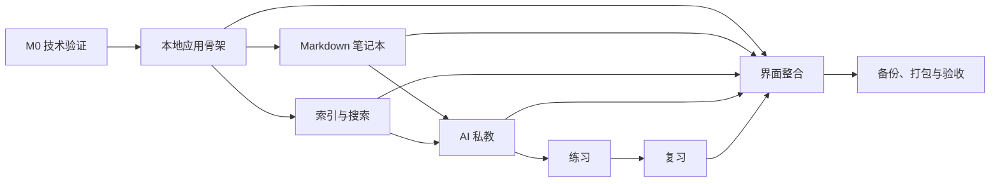

# StudyNotes MVP 功能拆解

状态：已拆分为 GitHub tickets  
依据：[产品规格](./PRODUCT-SPEC.md)  
Tickets：[索引](./tickets/INDEX.md)

## 1. 交付目标

交付一个可在 macOS 运行的本地优先应用，完成：

> 关联本地 Markdown/PDF workspace → 阅读并提问 → 检查引用 → 生成并完成练习 → 形成知识缺口 → 后续复习 → 备份恢复。

首版同时保留本地 Web 运行方式。Linux/Windows 打包在 macOS 版本稳定后补入。

## 2. 里程碑

### M0：技术验证

目标：在进入完整实现前排除不可逆技术风险。

| ID | 工作项 | 产出 | 完成标准 |
| --- | --- | --- | --- |
| S01 | BlockNote/Markdown sidecar 往返 | 最小可运行验证 | 标题、列表、引用、代码、表格、图片、自定义块经保存和外部修改后不静默丢失 |
| S02 | PDF 引用锚点 | 最小验证 | 页码、片段和内容哈希可稳定关联，外部重排后可识别失效 |
| S03 | Electron 本地运行时 | 启动原型 | Electron 能启动和关闭本地后端与 Web UI，异常退出可恢复 |
| S04 | OpenAI-compatible 流式调用 | API 验证 | 支持流式、取消、错误分类与重试 |
| S05 | 七牛公开桶上传 | 上传验证 | Keychain 读取凭据、随机对象键、HTTPS URL 和删除权限可用 |
| S06 | 文件监听与冲突 | 文件系统验证 | 外部创建、修改、移动、删除不导致数据丢失 |
| S07 | 本地检索降级 | 检索验证 | 无 embedding 时全文检索可用，开启向量后引用格式一致 |

### M1：应用骨架与本地工作区

依赖：S03、S06。

| ID | 工作项 | 完成标准 |
| --- | --- | --- |
| F01 | Web/本地后端/桌面壳工程骨架 | 一条开发命令启动 Web 与后端；Electron 使用同一 Web UI |
| F02 | 应用数据目录与迁移机制 | 设置、SQLite、索引、缓存和日志路径可配置并带版本迁移 |
| F03 | 系统凭据存储 | 模型与七牛密钥写入 Keychain，不进入普通配置文件 |
| F04 | Workspace 注册与切换 | 支持多个本地目录，同一时间只激活一个 |
| F05 | 资料扫描与文件树 | 目录映射章节、`.md` 映射页面，忽略规则可配置 |
| F06 | 文件监听与重扫 | 外部变更可增量处理，路径失效有明确恢复入口 |
| F07 | 一级导航 | Workspace、Review、Settings 与 `Cmd+K` 搜索入口可用 |
| F08 | 三步首次启动 | 用户可完成目录、模型、可选七牛配置 |

### M2：Markdown 笔记本

依赖：S01、F05、F06。

| ID | 工作项 | 完成标准 |
| --- | --- | --- |
| N01 | Markdown 读取与 BlockNote 渲染 | `.md` 可打开并转换为 BlockNote 块 |
| N02 | `.md` 原子保存 | 保存后外部编辑器可立即读取完整内容 |
| N03 | `.md.note.json` sidecar | 块 ID、自定义属性和布局可保存、读取和重建 |
| N04 | 外部修改冲突 | 有未保存内容时显示差异/冲突，不静默覆盖 |
| N05 | 自动保存、撤销与恢复 | 异常退出后可恢复未保存草稿 |
| N06 | 页面树与文件操作 | 新建、重命名、移动、删除反映到文件系统 |
| N07 | 标签与 frontmatter | 解析 YAML 标签和正文标签，可搜索和筛选 |
| N08 | 模板 | 可配置模板目录并从模板创建页面 |
| N09 | 每日笔记 | 可按日期打开或创建每日笔记 |
| N10 | 页面链接与反向链接 | 标准相对链接和 Wiki Link 均可解析，反向链接可跳转 |
| N11 | BlockNote 基础块 | 段落、标题、列表、引用、代码、表格、分隔线和图片可用 |
| N12 | 图片插入与七牛上传 | 上传中、成功、失败状态可见；失败不写入 Markdown |
| N13 | 已有本地图片兼容与迁移 | 相对路径图片正常显示；显式迁移后才改写链接 |

### M3：索引与搜索

依赖：F05、F06、S07。

| ID | 工作项 | 完成标准 |
| --- | --- | --- |
| I01 | 文档解析器接口 | Markdown、文本和 PDF 输出统一 Source document |
| I02 | 本地全文索引 | 标题、路径、标题层级、正文和标签可检索 |
| I03 | 增量索引任务 | 按内容哈希更新，展示进度、失败和重建入口 |
| I04 | 引用锚点 | Markdown 保存标题路径/块 ID/哈希；PDF 保存页码/文本/哈希 |
| I05 | 可选向量索引 | embedding 配置后启用，关闭或失败时回退全文 |
| I06 | `Cmd+K` 全局搜索 | 页面、正文、标签、会话、缺口、练习统一入口与精确跳转 |
| I07 | 反向链接索引 | 文件移动或改名后刷新链接关系 |

### M4：AI 私教

依赖：S04、I02、I04、N10。

| ID | 工作项 | 完成标准 |
| --- | --- | --- |
| A01 | 模型设置与连接测试 | 支持 Base URL、Key、聊天模型和可选 embedding |
| A02 | Learning session | 会话必须绑定 workspace 与至少一个资料位置 |
| A03 | 上下文组装 | 合并当前选区/页面、固定来源和自动检索片段，去重并限额 |
| A04 | 流式回答 | 支持流式、停止、重试、错误显示和会话恢复 |
| A05 | Grounded answer | 回答返回结构化引用；无效引用触发重试或降级 |
| A06 | 资料不足与非资料补充 | 三种回答类型可识别、展示和持久化 |
| A07 | 引导式/直接解释 | 默认追问引导，用户可显式切换为直接解释 |
| A08 | 上下文抽屉 | 可查看实际发送片段和引用范围 |
| A09 | 块级讨论 | 每个 Markdown 块或 PDF 选区可建立独立线程 |
| A10 | 会话历史 | 搜索、重命名、归档和删除不删除学习记录 |
| A11 | 练习建议 | 会话结束时可建议生成练习，不自动弹题 |

### M5：练习、缺口与复习

依赖：A05、A06、A11。

| ID | 工作项 | 完成标准 |
| --- | --- | --- |
| P01 | Practice item 数据与界面 | 单选题和短答题可创建、编辑、删除 |
| P02 | 练习生成 | 从会话/资料默认生成 3 题，支持 1 至 10 题 |
| P03 | 单选题作答 | 选择答案后展示正确答案、解释和引用 |
| P04 | 短答题反馈 | 展示参考要点、评分依据、命中项、遗漏项和引用 |
| P05 | 自评修正 | 用户可修改结果，保存 AI 初评与最终自评 |
| P06 | Gap record | 可从练习或会话创建并关联资料证据 |
| R01 | Review item 调度 | 1、3、7、14 天间隔，重来重置为 1 天 |
| R02 | 今日复习队列 | 到期项按截止时间排序，单批最多 20 项 |
| R03 | 复习交互 | 作答、查看依据、选择重来/通过、写入下一次日期 |
| R04 | 手动调整 | 用户可修改或清除复习时间 |

### M6：Review 页面与完整工作区整合

依赖：F07、R02、R03。

| ID | 工作项 | 完成标准 |
| --- | --- | --- |
| U01 | Workspace 三栏界面 | 资料树、编辑器/PDF、私教面板整合 |
| U02 | PDF 沉浸阅读 | 页面/大纲、PDF、选区提问和引用跳转可用 |
| U03 | Review 驾驶舱 | 到期项、缺口、继续学习和本周目标整合 |
| U04 | 上下文和引用视觉 | 有据回答、证据、非资料补充和失效引用状态清晰 |
| U05 | 简体中文与基础国际化 | 所有可见文案中文，文案不硬编码在业务逻辑中 |
| U06 | 空、加载、错误、离线状态 | 关键页面具备真实状态，不出现假数据或假进度 |

### M7：备份、打包与验收

依赖：M1 至 M6。

| ID | 工作项 | 完成标准 |
| --- | --- | --- |
| B01 | 备份导出 | 打包设置、会话、练习、缺口、复习和 sidecar 校验信息 |
| B02 | 备份恢复 | 恢复前预览并创建回滚副本，失败不破坏当前数据 |
| B03 | 本地 Web 发布 | 可在 macOS 浏览器中运行完整产品 |
| B04 | macOS Electron 打包 | 双击启动、关闭、崩溃恢复和本地数据路径通过测试 |
| B05 | Linux/Windows 打包预留 | 平台适配接口和构建脚本不绑定 macOS 专有路径 |
| Q01 | 核心端到端测试 | 首次启动、Markdown、PDF、辅导、练习、复习和备份通过 |
| Q02 | 数据安全测试 | 外部文件冲突、索引删除、sidecar 损坏和备份中断不丢数据 |
| Q03 | 用户验收 | 5 位用户完成规格定义的闭环，达到成功标准 |

## 3. 并行工作流

完成 M0 后，可拆成以下互不阻塞的工作流：

1. **桌面与本地运行时**：F01-F03、B03-B05。
2. **文件系统与 Markdown**：F04-F06、N01-N13。
3. **解析、索引与搜索**：I01-I07。
4. **AI 私教运行时**：A01-A11。
5. **练习与复习**：P01-P06、R01-R04。
6. **界面整合与验收**：U01-U06、Q01-Q03。

共享契约必须先生成：

- Source document/citation 契约。
- Learning session/turn event 契约。
- Practice item/attempt 契约。
- Workspace/source index 状态契约。

上述契约变更需要同时更新前后端类型、生成物与端到端测试。

## 4. 关键依赖

## 5. 实施门禁

每个工作包完成时必须满足：

1. 有对应验收条件。
2. 涉及文件写入时验证原子写入和失败恢复。
3. 涉及 AI 输出时验证引用有效性。
4. 涉及索引时验证增量更新与完整重建。
5. 涉及 UI 时在 1280×800 和 1600×1000 桌面视口检查布局。
6. 不把七牛或模型密钥写入日志、测试快照或仓库。

## 6. 首轮不应启动的工作

- 云端账号、同步、多用户和协作。
- DeepTutor 的 Partners、Memory、Books、Mastery、Research、Visualize。
- 插件系统、MCP、CLI 应用市场和远程技能。
- OCR、DOCX、PPTX、音视频与本地模型。
- 自动更新服务器和遥测平台。

## 7. 完成定义

MVP 完成需同时满足：

- 产品规格第 10、11 节所有验收项通过。
- 5 位用户完成至少 15 次完整学习闭环。
- 没有已知的静默文件损坏或学习记录丢失问题。
- macOS 桌面安装包可由非开发用户完成首次配置。
- 本地 Web 模式与桌面模式使用同一业务 UI 和同一数据契约。
